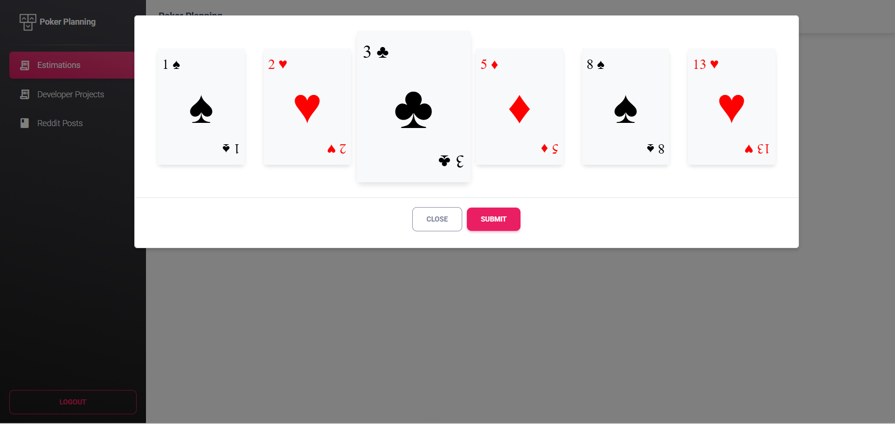
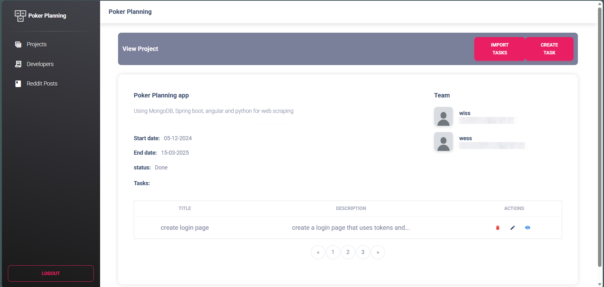
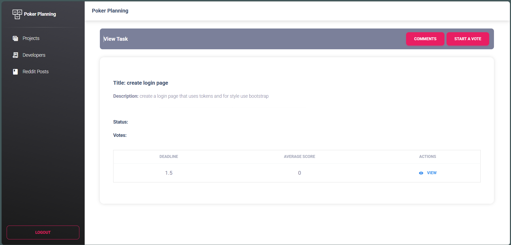
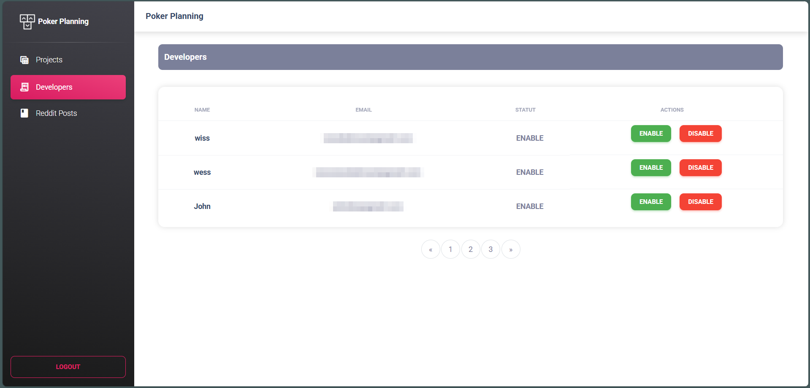
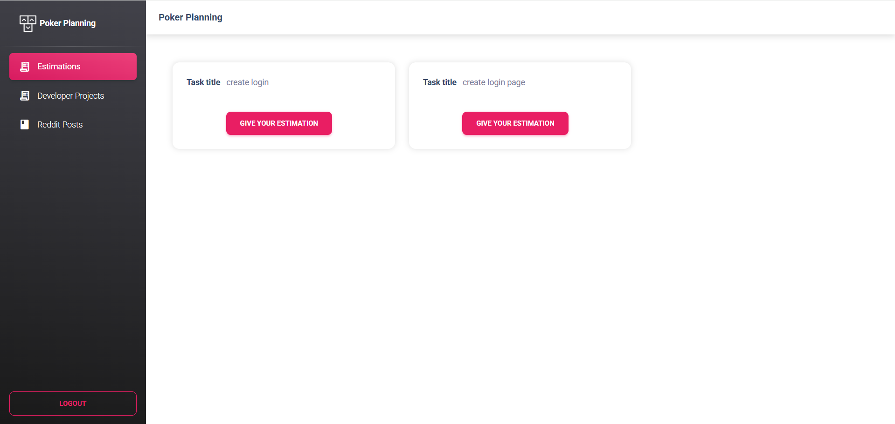
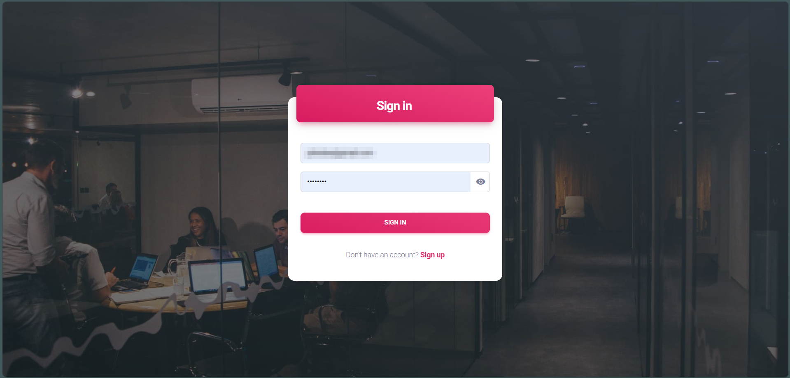
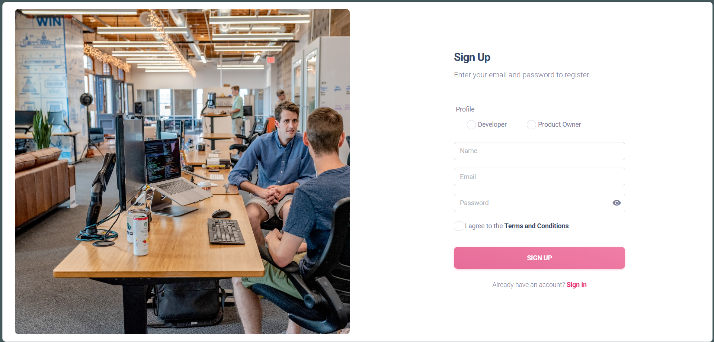
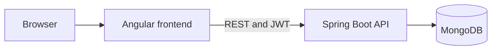

# PokerApp: Planning Poker for Scrum Teams

A full-stack web app that helps Scrum teams manage projects and estimate tasks together using Planning Poker. Product owners open timed voting rounds, developers vote with Fibonacci cards, and the app calculates the average score.

Built with **Spring Boot**, **Angular**, and **MongoDB** as a team project during my Full-Stack Developer internship at Attijari Bank (July–September 2024). The app was later adopted by Scrum teams at the bank for their project planning.



## Features

### Product owners
- Create and edit projects, and assign developers to them
- Create, edit, and delete tasks
- Import projects and tasks from Excel
- Start a timed vote on a task and review the results
- Enable or disable developer accounts

### Developers
- See the projects they are assigned to
- See open votes and estimate with cards (1, 2, 3, 5, 8, 13)

### Across the app
- Sign-up with a Product Owner or Developer role, JWT sign-in, and a separate workspace for each role
- Comments on tasks
- REST APIs for projects, sprints, tasks, comments, estimations, and scores

## Screenshots

| Product owner: project | Product owner: task and vote |
|---|---|
|  |  |

| Product owner: developers | Developer: open estimations |
|---|---|
|  |  |

| Sign in | Sign up |
|---|---|
|  |  |

## Architecture



## Tech stack

| Area | Technologies |
|---|---|
| Backend | Java 22, Spring Boot 3.3, Spring Security, Spring Data MongoDB, JJWT, Apache POI |
| Frontend | Angular 18, TypeScript, Material Dashboard 2 |
| Database | MongoDB |
| Tooling | Docker, Docker Compose, Maven, Jira |

## Getting started

### Run with Docker

You need Docker with Docker Compose.

```bash
git clone https://github.com/wissou11/poker-planning.git
cd poker-planning
cp .env.example .env
```

Generate a key with `openssl rand -base64 64`, add it to `.env` as `JWT_SECRET`, then start the app:

```bash
docker compose up --build
```

Open http://localhost:4200 and sign up. Create one Product Owner and at least one Developer to try a full voting round.

### Run without Docker

You need Java 22, Node.js 20 or later, and MongoDB running on port 27017.

```bash
# Add the sign-up roles to the database (first run only)
mongosh mongodb://localhost:27017 database/init/seed-roles.js

# Backend, on http://localhost:8080
cd PokerPlanningBack
./mvnw spring-boot:run

# Frontend, on http://localhost:4200 (in a second terminal)
cd PokerPlanningFront
npm install
npx ng serve
```

## Excel import

Upload an `.xlsx` file containing a sheet with one of these names and columns, in this order:

| Sheet | Columns |
|---|---|
| `projects` | creator, title, description, start date, end date, status |
| `tasks` | title, description, project ID, status, duration |

## Project structure

```text
poker-planning/
├── PokerPlanningBack/      Spring Boot REST API
├── PokerPlanningFront/     Angular application
├── reddit web scraping/    Notebook behind the Reddit Posts page
├── database/init/          Sign-up roles for MongoDB
├── docs/screenshots/       Images used in this README
├── docker-compose.yml
└── .env.example
```

## My contributions

- Contributed to the application's architecture
- Developed backend REST APIs with Spring Boot
- Built frontend interfaces with Angular
- Designed and managed the MongoDB collections
- Implemented the collaborative voting feature
- Took part in sprint planning and Agile development, using Jira to track work

## Known limitations and next steps

- **API security:** sign-in issues a JWT, but the API doesn't yet require it. The next step is to protect every endpoint except sign-in and sign-up, and to check roles on the server.
- **Sprints:** sprint management is available through the API but not yet in the interface.
- **Live updates:** votes are sent over REST and the countdown runs in the browser. WebSockets could show votes to the team as they arrive.
- **Configuration:** API addresses are hardcoded in the frontend and CORS is open. Both should be configured per environment before deployment.
- **Tests:** add backend tests for sign-in and score calculation.

## Credits

The interface uses [Material Dashboard 2](https://www.creative-tim.com/product/material-dashboard) by Creative Tim, available under the MIT License.
